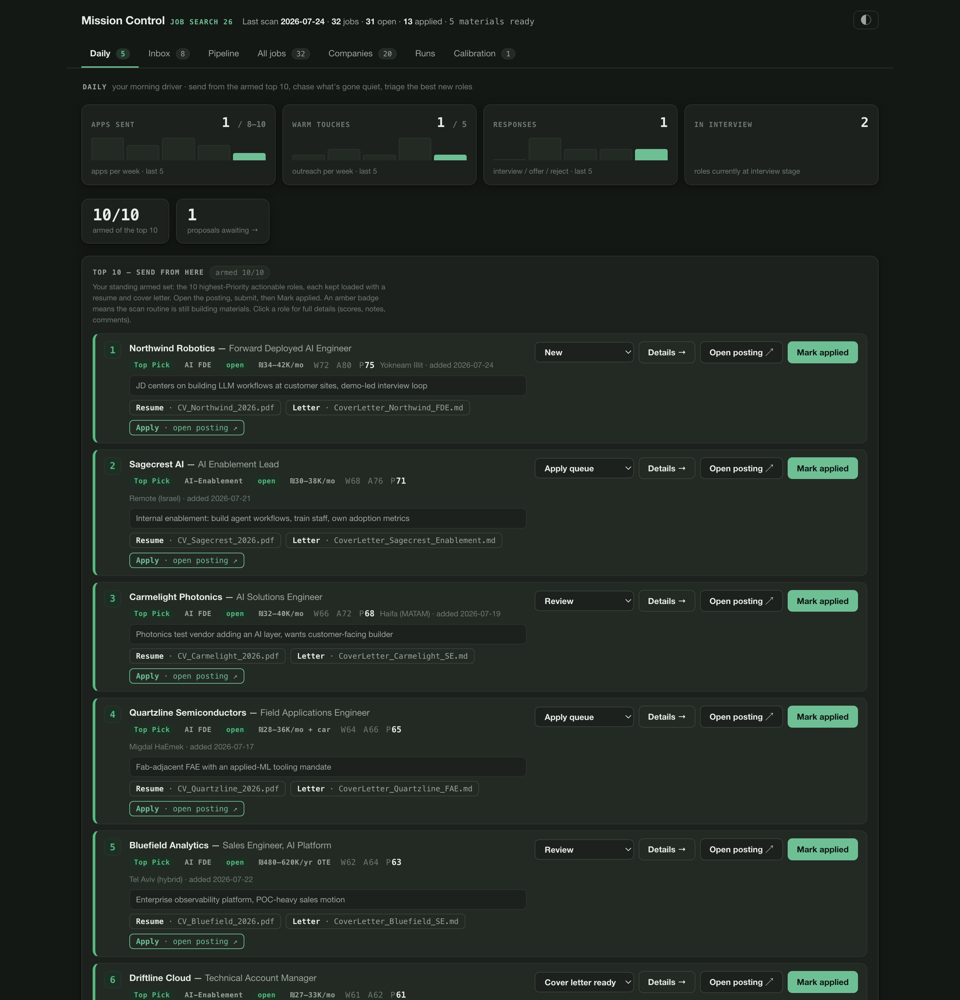

ב״ה

# Colin David Olivier

I help technical teams adopt new tools, and I build with AI coding agents every day. For more than a decade I worked with technical customers in life-science R&D: discovery, demos, capital equipment closes, customer training and support. From 2024 to 2026, as AI Operations Lead for a nonprofit, I was on the other side of the table. I led the organization's move to a production CRM and digital intake system that I built hands-on with agentic coding tools, with a human approving what the agents propose.

**How I work:** I design the system, write the specs, guardrails and runbooks, then direct AI coding agents to build it. I review, test, and run the result in production. The flagship project below runs unattended twice a week.

**Looking for:** AI Deployment, Field Engineering and Solutions Architecture roles: owning rollout and enablement after the sale, and translating between technical customers and the product team. Based in Ramat Yishai, Israel (aliyah April 2025); open across Israel and remote. US & Israeli citizen · native English, conversational Hebrew.

---

## ▶ Three demos you can click through right now

No signup, no install. Each one opens straight into the product, runs on invented data, and
carries a banner saying exactly what is real and what is stubbed.

**[colinolivier.vercel.app](https://colinolivier.vercel.app)** — all three in one place.

| | | |
|---|---|---|
| **[Restaurant ordering & delivery](https://demo-restaurant-ordering.vercel.app)** | Bilingual EN/HE menu with RTL, cart, zone-priced delivery checkout, live order tracking, kitchen board. Shabbat and yom-tov closures computed from the Hebrew calendar. | [source](https://github.com/Neuralowkey/demo-restaurant-ordering) |
| **[LeadGraph](https://demo-leadgraph.vercel.app)** | Turns research publishing activity into ranked, explainable biotech sales leads. 3D co-authorship graph, deck.gl globe, and a weight tuner that re-ranks the run live. | [source](https://github.com/Neuralowkey/demo-leadgraph) |
| **[Yeshiva Operating System](https://demo-yeshiva-os.vercel.app)** | A school back office built around an approval queue: agents propose, people decide, every decision is audited. Plus seder attendance and a QuickBooks reconciliation surface where the matcher says why it is unsure instead of guessing. | [source](https://github.com/Neuralowkey/demo-yeshiva-os) |

---

### 🗂 Production CRM rollout for a nonprofit

As AI Operations Lead (2024–2026) I led a nonprofit's move to modern operations software as a one-to-two-person team. I built it with agentic coding tools on Next.js, TypeScript, PostgreSQL and Prisma: multi-pipeline contact management, donation and financials tracking with QuickBooks duplicate detection, role-based access, safe data-migration importers, public intake forms, lead-capture webhooks with UTM attribution, and an audited approval queue that keeps a human between AI agents and the database. Alongside it I built LLM and agent prototypes (Claude and OpenAI APIs) for ranking and monitoring, with lightweight evaluation checks. Running in production for a real organization; the code is private to the client.

**[Try the demo version →](https://demo-yeshiva-os.vercel.app)** — six of its screens rebuilt on invented data, with the approval queue front and centre.

### 🎛 Mission Control — an agentic pipeline that runs my job search

An AI agent sweeps a dozen job boards twice a week, scores every role against a rubric that learns from my feedback, and keeps the ten best openings loaded with a tailored resume and cover letter. FastAPI dashboard, a human-state vs machine-state split that makes unattended reruns safe, 54 tests. Screenshots use synthetic demo data.

**[Read the case study →](https://github.com/Neuralowkey/mission-control)**

**Also building, on my own time:** an agentic short-form video production pipeline, and a laptop-first live audio-visual performance rig (JUCE engine, Electron UI, Python prep).

---

**Stack:** Next.js, TypeScript, PostgreSQL, Prisma, Vercel, Python, FastAPI, SQLite, Claude Code and agent runbooks, Claude and OpenAI APIs, headless Chrome rendering pipelines.

**Before AI:** more than a decade in life-science technical sales, training and support. At ADInstruments (physiology data acquisition) I did consultative outside sales to biomedical research labs, then worked as a Training and Support Engineer. At Visiopharm (digital pathology AI) I added over $2M in new opportunities to the funnel from outbound-only cold campaigns in 2019, and helped design and build the publication database the team used to find and rank researchers. At NeuroNexus (neural interfaces) I was an Account Executive, then Sales Development Manager. It started in a behavioral neuroscience lab at CU Boulder. Across all of it, the job was to stand next to the scientist, make the instrument do what they need, and translate between the lab and the product team.

📫 colindolivier@gmail.com · [LinkedIn](https://www.linkedin.com/in/colinolivier) · Ramat Yishai, Israel
